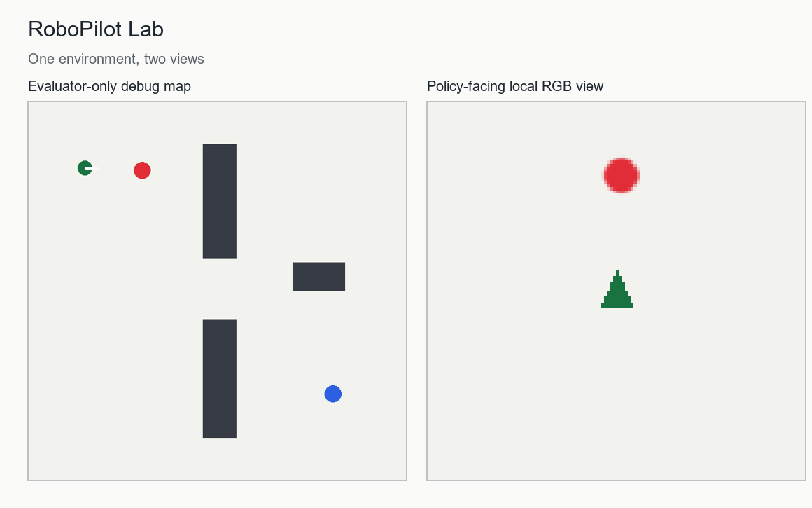

# RoboPilot Lab

**A vision-guided mobile robot agent, built and evaluated one layer at a time.**

This is an in-progress portfolio project. A robot receives an egocentric **overhead RGB crop** and a language task such as “visit red, then blue.” The intended system combines visual perception, a high-level task agent, a differential-drive controller, and a safety supervisor. The first committed slice is a deterministic 2D simulator, not a completed AI model or a real-robot result.



## Why this project

It connects three independently testable abilities: learning from images, sequential decision-making, and reliable agent execution. It also creates a concrete place to compare a classical vision/controller baseline, an imitation-learned visual policy, and a tool-using planner. A model only earns a place in the system if it improves a held-out benchmark.

## Current working slice

- Continuous 2D robot pose and differential-drive-like velocity commands.
- Rectangular obstacles, collision checks, and two colored stations.
- A rendered local RGB observation that exposes no coordinates to the policy.
- A separate debug map for inspecting episodes.
- Deterministic reset and tests for movement, collisions, and observation boundaries.

The current camera is a **simulated local overhead view**, not a physical onboard camera. Future milestones may add a forward camera or a physics simulator. Results will be reported with this distinction explicit.

## Run

```powershell
python -m pip install -e .
python -m unittest discover -s tests -v
python -m robopilot.demo
python scripts/render_preview.py
```

The demo writes two PNGs to `results/` (ignored by Git).

## Planned system

```text
language task + local RGB observation
          |                |
          |          visual perception
          |                |
          +------ task agent / waypoint choice
                           |
                    low-level controller
                           |
                    safety supervisor
                           |
                    simulator + trace
```

## Evaluation contract

The policy may read only `Observation.image`, `Observation.instruction`, and its own history. Environment pose, station coordinates, obstacle rectangles, and reward labels belong to the simulator/evaluator only. We will freeze train/validation/test seeds before model training. Headline metrics will be goal completion, collisions, path efficiency, decision latency, and success under visual noise and unseen layouts. Baselines and ablations must use the same cases.

See [the Chinese build plan](docs/build-plan.zh-CN.md) for milestones and the first exercise. No performance claim belongs on a CV until it is measured and reproducible.
